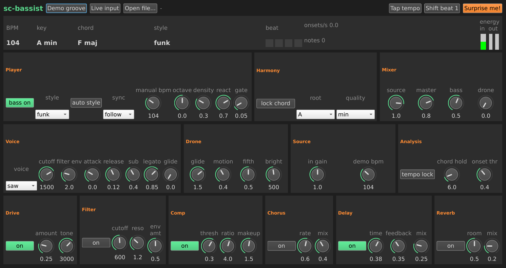

# sc-bassist

A live bass player in SuperCollider.
It listens to whatever you feed it (a YouTube tab, a file, the demo groove,
later an external audio interface),
follows the beat, key, chords and energy,
and plays a bass line through an effects section you control from a window.



## Start

```bash
make install-sc   # once: SuperCollider 3.11 without root, see below
./run.sh          # demo groove: a bass player jams with it right away
```

Other ways to start:

```bash
./run.sh --live              # listen to the audio input (YouTube, see next section)
./run.sh --file song.mp3     # play along with a file (any format ffmpeg reads)
./run.sh --nogui             # engine only, control it over OSC
```

Close the window to quit.
`make help` lists the targets.

### Installing SuperCollider

`make install-sc` (`scripts/install-local-sc.sh`)
unpacks Ubuntu's SuperCollider packages into `~/.local/opt/supercollider`.
No root, and the audio system stays as it is:
on a PipeWire desktop `sudo apt install supercollider`
would replace `libjack0` with jackd2's library and add a JACK server.
`run.sh` uses that prefix, or a system `sclang` if there is one,
and talks to PipeWire through its JACK library.
No sc3-plugins are needed: everything uses core UGens.

## Play YouTube into it, hear the mix on your headphones

1. `./run.sh --live`
2. Play the video in the browser.
3. Link the browser's audio into sc-bassist:

   ```bash
   scripts/route-app.sh firefox             # or chromium, chrome, ...
   scripts/route-app.sh --list              # if you are unsure of the name
   ```

   You hear the video as before, plus the bass from sc-bassist.
   Use the **Mixer** (bass, drone, master) to balance them.

4. Want the whole mix under sc-bassist's control?

   ```bash
   scripts/route-app.sh firefox --through
   ```

   This unlinks the browser from your headphones,
   so you hear it only through sc-bassist;
   turn **source** up in the Mixer.
   The browser goes back to normal when you restart playback
   (or relink it in qpwgraph/helvum).

### Music without bass

Backing tracks made for bass players leave the bass out on purpose,
and usually say tempo and key in the title:
search YouTube for **"no bass backing track"** or **"bassless backing track"**,
for example
[funk, Bm, 100 BPM](https://www.youtube.com/watch?v=InEAyxVO6So),
[funk, 112 BPM](https://www.youtube.com/watch?v=gcpIv2kzUn0),
[disco funk, G, 110 BPM](https://www.youtube.com/watch?v=LMbyAgGbMFI),
or the playlist [Bass-less Backing Tracks – The Jam Station](https://www.youtube.com/playlist?list=PL3jMUJrXvHwHFiXjnGKifYqWBBXbLcVqe).

To play one from a file instead:
`./run.sh --file "$(scripts/fetch-youtube.sh URL)"` (needs yt-dlp;
only download what you may).

## The window

- **Top bar**: source (demo / live / file), *Tap tempo*,
  *Shift beat 1* (the beat tracker knows beats, not bars: press until the
  bass lands on "one"), and *Surprise me!* (random style, voice and effects).
- **Status**: BPM, key, chord, style (and what auto-style hears),
  a beat lamp per beat of the bar, onsets per second,
  energy and in/out meters.
- **Player**: style, *auto style*, sync (*follow* the detected beat or
  *manual* tempo), octave, *density* (how busy), *react* (how much the
  input's energy makes it busier), *gate* (stops when the input is quiet).
- **Harmony**: *lock chord* to play over a fixed root when detection wanders.
- **Mixer**: source, master, bass (after the effects), drone.
- **Voice**: saw, pulse, round, fretless; filter, envelope, sub, legato, glide.
- **Drone**: glide time, motion, fifth, brightness.
- **Effects**: drive, envelope filter, compressor, chorus, delay, reverb,
  each with its own on/off.

### Styles

| style | what it plays |
|---|---|
| roots | quarter-note roots |
| rootFifth | root and fifth |
| octaves | eighth-note octaves (disco) |
| funk | syncopated sixteenths, ghost-y octaves, approach notes |
| walking | root, third, fifth, chromatic approach |
| sparse | one long note per bar, a fifth when it gets loud |
| runs | generative virtuoso lines: chord-scale runs in 16ths, 32nds at high energy, octave leaps, slides, ghost notes, chromatic approach into the next bar (in the spirit of Tom Jenkinson's playing, not a copy of it) |
| drone | no line; a sustained root and fifth that glides with the chords |

*Auto style* picks the style from the input's feel:
quiet → drone, few onsets → sparse, busy and loud → runs,
bright and medium-busy → funk, otherwise root-fifth.
A suggestion has to hold for about two seconds before it switches.

### Things to try

- *runs* + *fretless* voice + a little *glide* + chorus.
- Raise **react**: the bass gets busier as the track gets louder.
- *drone* style with delay and reverb under an ambient track.
- *Surprise me!* until something sticks, then fine-tune.
- `--through` routing and ride the **source** fader like a DJ.

## Remote control (OSC)

Every control can be set over OSC on sclang's port (57120):

```text
/sb/set <param> <value>      e.g. /sb/set style 6   /sb/set cutoff 900
/sb/do demo | live | tap | surprise | shift
/sb/do file <path>
```

Parameter names are the keys in `src/*.scd` (`~sb.addParam(\cutoff, ...)`).
TouchOSC or a small web page on a phone can drive it this way (#18).
sclang listens on all interfaces: use it on a network you trust.

## How it works

```text
source (demo | live | file) ──► source bus ──► monitor ──► mixer ──► out
                                    │
                                    ▼
analyser: BeatTrack, KeyTrack, 48-band chroma, Amplitude, Onsets, SpecCentroid
                                    │ OSC (beats, features)
                                    ▼
language: chord detection + hysteresis, tempo, energy, auto-style
          player: on every beat → notes for that beat (theory.scd)
                                    │
                                    ▼
bass voice + drone ──► bass bus ──► effects ──► bass fader ──► out
```

| file | role |
|---|---|
| `main.scd` | boots the server, starts the modules, opens the window |
| `src/core.scd` | parameter registry (`~sb.setParam`), buses, groups |
| `src/theory.scd` | chords, styles, runs, tempo folding, auto-style rules (pure, unit-tested) |
| `src/sources.scd` | demo groove, live input, files |
| `src/analysis.scd` | analyser synth and feature handling |
| `src/player.scd` | beat handling, manual clock, tap, surprise |
| `src/voice.scd`, `src/drone.scd`, `src/fx.scd` | sound |
| `src/ui.scd`, `src/remote.scd` | window and OSC |

## Tests

```bash
make test        # or: scripts/test.sh [compile] [unit] [ui] [integration]
```

All suites are silent: the engine writes to a private bus.

- **compile**: every file parses, every SynthDef builds.
- **unit**: theory and player logic without a server.
- **ui**: builds the window offscreen, checks the widgets, saves `out/ui.png`.
- **integration**: boots the engine on the demo groove (104 BPM, Am F C G)
  and checks tempo, chords, notes, every style, the drone, the mix balance
  (bass vs. source level), OSC control and mp3 input.

The harness is `tests/harness.scd` (SuperCollider has no built-in test framework).
sclang has no line-coverage tool either, so `test.sh` reports **function
coverage**: every function of the engine and the theory module is wrapped
with a call counter, the counts are merged over the suites,
and functions that no test calls are listed (currently 45/45).
It says nothing about branches inside a function.

CI runs lint (shellcheck) and the suites on Ubuntu 22.04 (SuperCollider 3.11)
and 24.04 (3.13) against a dummy JACK server,
and uploads logs and the UI screenshot.

## Limits

- Chord detection uses major/minor triads from a chroma filter bank:
  good on clear pop, funk and rock, unsteady on dense or jazzy harmony
  (use *lock chord*). Drums leak into the chroma (#12).
- BeatTrack needs a few seconds to lock and knows no bar position
  (*Shift beat 1*).
- Latency follows your audio setup: notes are triggered on the predicted
  beat, but there is no latency compensation yet (#16).

## Roadmap

See the [issues](https://github.com/ChristianGeng/sc-bassist/issues):
locking to the kick drum (#12),
an input library (#13), a mix evaluator (#14)
and a self-improving loop on top of both (#15),
external audio interfaces (#16), MIDI (#17), a phone remote (#18),
recording (#19), learned style and chord recognition (#20).
